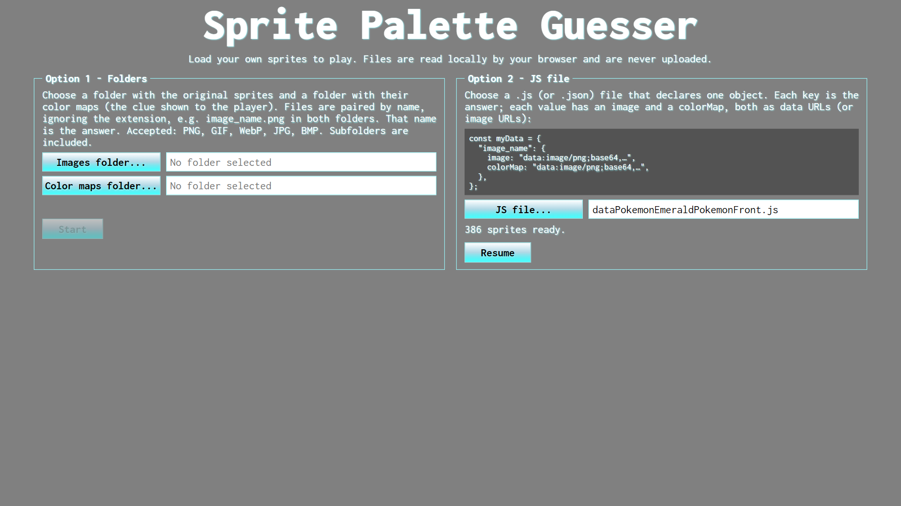
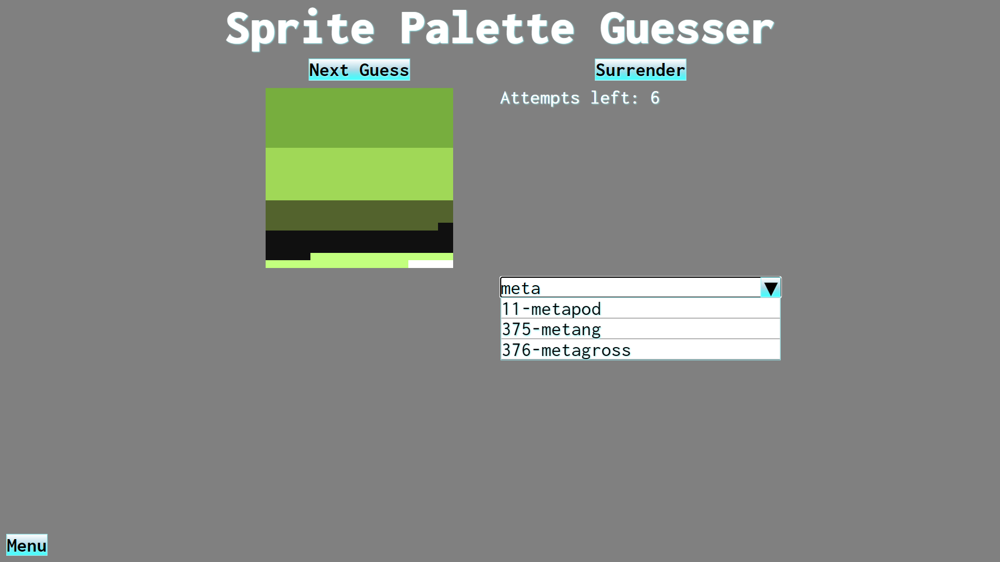

# Sprite Palette Guesser


## Description

This is a browser game where you identify sprites from their color palette.




## Usage instructions

Go to https://felipert98.github.io/SpritePaletteGuesser/

OR

1. Clone or download this repository.
2. Open index.html in your web browser.

No installation or additional software is required.

## Providing your sprites

The game does not include any images: you provide them on the start screen. Files are read locally by your browser and are never uploaded anywhere.

Each sprite needs two images:

- **Image**: the original sprite, revealed when the round ends.
- **Color map**: the sprite's color palette rendered as an image (colors only, without the sprite's shape). This is the clue shown to the player.

The name of the sprite is the answer, and it is what appears in the search list. Use names that are easy to search.

### Option 1: Folders

Select two folders using the **Images folder...** and **Color maps folder...** buttons.

- Files are paired by name, ignoring the extension and the letter case
- Accepted formats: PNG, GIF, WebP, JPG, BMP.
- Subfolders are included.
- Files without a pair are skipped (the start screen tells you how many).

```
sprites/
  images/
    1_image.png
    2_image.png
  colormaps/
    1_image.png
    2_image.png
```

### Option 2: JS file

Select a `.js` (or `.json`) file using the **JS file...** button. The file must declare a single object where each key is the answer and each value has an `image` and a `colorMap`, both as data URLs (or image URLs):

```js
const myData = {
  "1_image": {
    image: "data:image/png;base64,...",
    colorMap: "data:image/png;base64,...",
  },
  "2_image": {
    image: "data:image/png;base64,...",
    colorMap: "data:image/png;base64,...",
  },
};
```

> **Security note:** a `.js` file is executed by the page in order to read it. Only load files you trust. A plain `.json` file is parsed without executing anything.

### Notes

- Folder selection needs a browser that supports directory upload (current versions of Chrome, Edge, Firefox and Safari).
- Use the **Menu** button during a game to go back to the start screen and load different sprites.